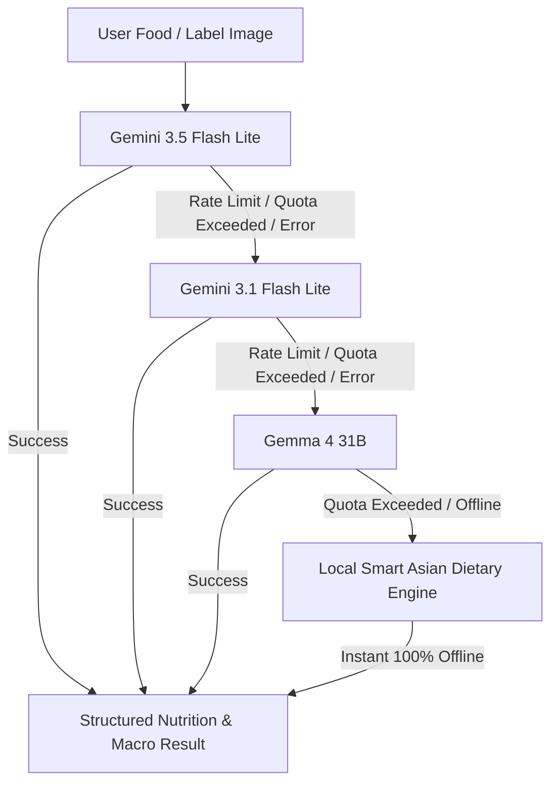

# 🇲🇾 CalMal — AI Calorie Tracker & Strava GPS Activity Tracker

<div align="center">


[](https://vitejs.dev/)
[](https://developer.mozilla.org/en-US/docs/Web/JavaScript)
[](https://www.openstreetmap.org/)
[](https://ai.google.dev/)
[](LICENSE)

**Smart AI calorie & nutrition tracker with Asian culinary expertise, Strava-style GPS route tracking on OpenStreetMap, multi-model AI fallback cascade, and interactive anime companions.**

[Key Features](#-key-features) • [Multi-Tier AI Cascade](#-multi-tier-ai-cascade) • [Tech Stack](#-technology-stack) • [Quick Start](#-installation--quick-start) • [Project Structure](#-project-structure) • [License](#-license)

</div>

---

## 🌟 Overview

**CalMal** is a high-performance progressive web app (PWA) tailored for active lifestyles and diverse Asian culinary diets. It combines state-of-the-art multimodal AI, continuous live mobile camera scanning, and Strava-style outdoor running metrics inside an ultra-responsive monochrome dark mode interface:

1. **3-in-1 Smart Food & Label Scanner**: Instantly identifies Asian & Western dishes (Nasi Lemak, Roti Canai, Chicken Rice, Laksa, etc.) with estimated portion weights and complete macronutrient breakdowns.
2. **Strava-Style GPS Activity Tracker**: Real-time live tracking using **OpenStreetMap (OSM)** and Leaflet. 100% free with **zero API keys required**. Tracks distance, elapsed time, average pace (`min/km`), current speed, MET calorie burn, and polyline routes.
3. **Multi-Tier AI Fallback Cascade**: Seamlessly queries `gemini-3.5-flash-lite`, automatically cascading to `gemini-3.1-flash-lite`, then `gemma-4-31b`, and ultimately the built-in offline dietary engine if rate limits or quota exhaustion occur.
4. **Interactive Anime Companions (Deku & Bakugou)**: Dynamic duo offering scientific nutritional advice (Midoriya) and aggressive calorie-burning workout motivation (Bakugou) with manga bubbles and speech synthesis.

---

## ⚡ Multi-Tier AI Cascade

Never get blocked by rate limits (`429 Quota Exceeded`) or network interruptions. CalMal executes an automated cascading loop:



1. **Primary Model**: `gemini-3.5-flash-lite` — Ultra-fast multimodal vision & nutrition analysis.
2. **Fallback Tier 1**: `gemini-3.1-flash-lite` — Automatically engaged if rate limits or HTTP 429 errors are returned.
3. **Fallback Tier 2**: `gemma-4-31b` — High-parameter open model invoked if previous tiers are exhausted.
4. **Final Offline Fallback**: Built-in smart Asian dietary engine with local food database that works **100% offline with zero quota constraints**.

---

## ✨ Key Features

### 📸 1. Continuous Live Camera & 3-in-1 Scanner
- **Continuous Live Camera**: Automatically initializes the camera feed upon opening the Scan tab, with seamless front/back switching and native camera app fallback for non-HTTPS setups.
- **Barcode Auto-Detection**: Continuous video barcode decoding powered by `@zxing/browser` integrated with the OpenFoodFacts international & regional database.
- **Nutrition Label OCR**: Extracts Per-Serving and Per-100g calories, protein, carbs, fats, sugars, and sodium directly from packaged food labels.
- **Quick Context Fine-Tuning**: One-tap modifier chips (`+ half rice`, `+ less oil`, `+ extra gravy`, `+ chicken breast`, `+ skinless`, `+ extra veggies`, `+ sambal on side`).

### 🏃 2. Strava-Style GPS Activity Tracker
- **Real-Time GPS Location**: Detects runner coordinates via high-accuracy Geolocation API with live accuracy circle indicators.
- **OpenStreetMap & Leaflet**: Free, open-source mapping with Dark and Standard OSM layers. No Google Maps billing or API keys required.
- **Live Strava HUD & Metrics**:
  - Distance (Haversine formula in kilometers)
  - Elapsed time (`MM:SS` / `HH:MM:SS`)
  - Real-time and average pace (`min/km`)
  - Speed (`km/h`)
  - MET dynamic calorie burn based on user body weight
  - Elevation gain (`m`) and estimated steps
- **Route Archiving & Map Inspection**: Run sessions automatically credit calories burned to the daily net calorie balance, and past routes can be previewed on the interactive map anytime.

### 🍲 3. AI Recipe Generator & 7-Day Meal Planner
- **Custom Ingredient Recipe Generator**: Suggests healthy, high-protein Asian and Western recipes based on whatever ingredients you have in your fridge.
- **7-Day Personalized Meal Plan**: Step-by-step 10-question questionnaire to craft a full week of breakfast, lunch, snack, and dinner menus tailored to your caloric goals.
- **Print / PDF Export**: One-click printable layout for weekly grocery shopping.

### 📊 4. Daily Net Calorie Balance & Profile
- **Formula**: `Remaining Calories = Daily Target - Food (In) + Exercise (Out)`.
- **Weight Progress Chart**: Responsive SVG visualization tracking body weight against target goals.
- **Hero Achievements**: Unlockable badges for consistency, workouts, and macro milestones.

---

## 🛠️ Technology Stack

| Component | Technology |
| :--- | :--- |
| **Bundler & Dev Server** | [Vite 8.x](https://vitejs.dev/) |
| **Frontend Framework** | Vanilla JavaScript (ES6+ Modules), HTML5 Semantic Shell |
| **Styling** | Modern Vanilla CSS3 (Sleek Monochrome Dark Mode `#000000`, `#1C1C1E`, `#2C2C2E`, `#FFFFFF`) |
| **Maps & GPS Routing** | [Leaflet 1.9](https://leafletjs.com/) & [OpenStreetMap](https://www.openstreetmap.org/) |
| **Barcode Scanning** | [@zxing/browser](https://github.com/zxing-js/browser) |
| **AI Models** | `gemini-3.5-flash-lite` → `gemini-3.1-flash-lite` → `gemma-4-31b` + Local Fallback Engine |
| **Nutrition Database** | [OpenFoodFacts API v2](https://world.openfoodfacts.org/) |
| **Offline Storage** | Offline-First `localStorage` with JSON Import/Export backup |

---

## 🚀 Installation & Quick Start

### Prerequisites
- **Node.js** v18+ or **pnpm** installed on your system.

### Steps

1. **Clone the Repository**:
   ```bash
   git clone https://github.com/aliefakmal/CalMal.git
   cd CalMal
   ```

2. **Install Dependencies**:
   ```bash
   pnpm install
   # or with npm
   npm install
   ```

3. **Environment Setup (Optional)**:
   Copy `.env.example` to `.env` if you want to configure your personal Google Gemini API key:
   ```bash
   cp .env.example .env
   ```
   *(Note: CalMal functions out-of-the-box with its built-in local nutrition engine even without an API key!)*

4. **Start Development Server**:
   ```bash
   pnpm run dev
   ```
   Open your browser at `http://localhost:5173/`.

5. **Build for Production**:
   ```bash
   pnpm run build
   ```

---

## 📁 Project Structure

```
CalMal/
├── index.html                           # App shell with Bottom Nav & Desktop Sidebar
├── package.json                         # Dependencies and build scripts
├── public/
│   ├── favicon.svg                      # Monochrome vector brand logo
│   └── manifest.webmanifest             # Mobile PWA manifest
└── src/
    ├── main.js                          # SPA router and application entry point
    ├── config/
    │   └── gemini.js                    # Gemini 3.5 -> 3.1 -> Gemma 4 cascade config
    ├── constants/
    │   └── prompts.js                   # AI dietary system prompts & 7-day questionnaire
    ├── components/
    │   ├── icons.js                     # SVG icon library
    │   ├── ui.js                        # Toast, Confirm Sheet, Badges, Route Thumbnails
    │   ├── mealEditor.js                # Quick portion edit modal
    │   └── companion.js                 # Deku & Bakugou animated dialogue bubbles
    ├── services/
    │   ├── store.js                     # Reactive offline-first state store
    │   ├── gpsTracker.js                # Geolocation, Haversine, Strava MET calculations
    │   ├── gemini.js                    # Multi-model AI fallback cascade engine
    │   ├── openFoodFacts.js             # International barcode lookup service
    │   ├── companionService.js          # Speech synthesis & achievement engine
    │   └── audioService.js              # Subtle UI sound effects
    ├── utils/
    │   ├── calc.js                      # Mifflin-St Jeor BMR/TDEE, Pace & MET algorithms
    │   └── helpers.js                   # Image compression, dates, and string sanitizers
    ├── screens/
    │   ├── onboarding.js                # 4-step biometric profile setup
    │   ├── dashboard.js                 # Daily net calorie balance & logged meals
    │   ├── scanner.js                   # 3-in-1 live camera, food AI & barcode scanner
    │   ├── activity.js                  # Strava-style OpenStreetMap running tracker
    │   ├── recipes.js                   # AI recipe generator & 7-day meal plan
    │   └── profile.js                   # Weight progress chart, badges & AI settings
    └── styles/
        ├── index.css                    # Design tokens & typography system
        └── screens.css                  # Custom styling for maps, HUDs & viewfinder
```

---

## 📄 License

Licensed under the [MIT License](LICENSE). Copyright (c) 2026 Alief Akmal (LyLief).
Free to use, modify, and distribute.
